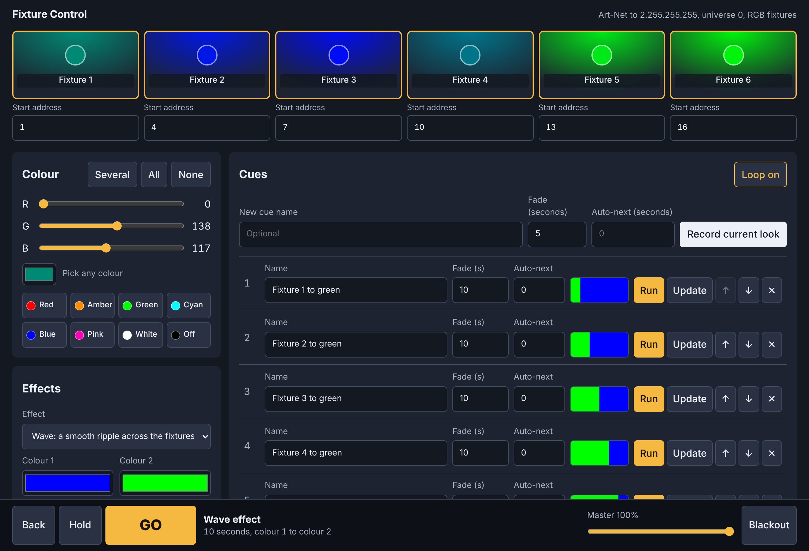
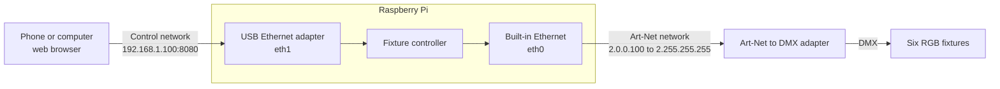
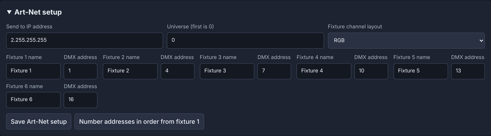
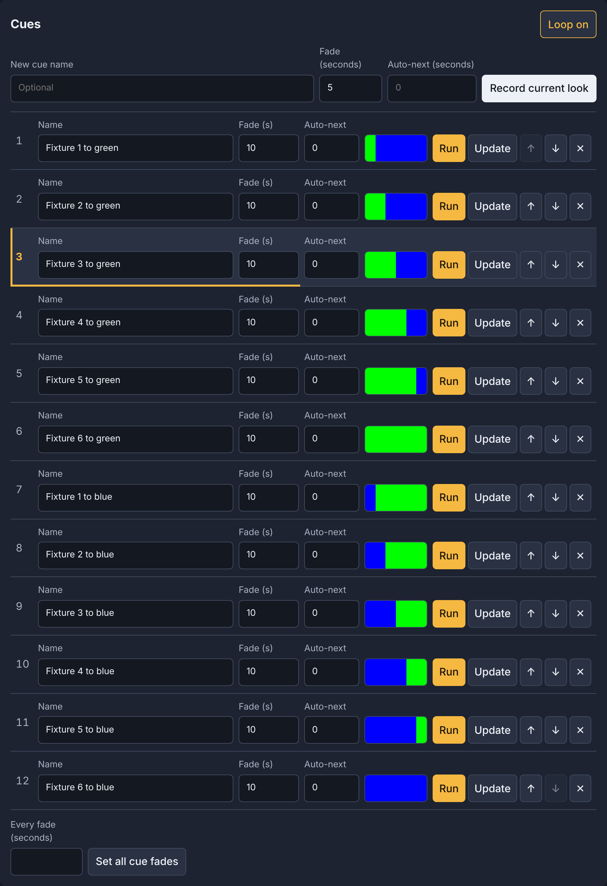
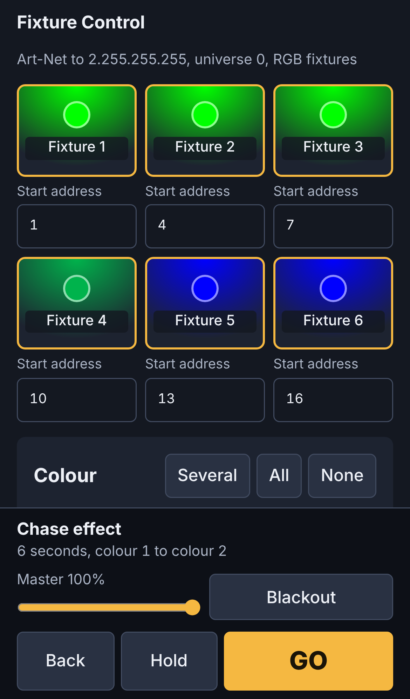

# Art-Net Fixture Controller

A six-fixture Art-Net lighting controller for Raspberry Pi. You control it from a web page on a phone or computer, and it runs your looks by itself after a power cut.

It was made for **Light Up Lancaster 2026**.



## What it does

- Controls six RGB fixtures over Art-Net, from any browser, with nothing to install on your computer
- Sets colours by hand on one fixture, several, or all six
- Records cues with fade times from 0 to 100 seconds, an optional automatic move to the next cue, and looping
- Runs **Wave** and **Chase** effects with your choice of two colours, time and direction
- Sets each fixture's DMX start address from its tile, and warns you if two fixtures overlap
- Includes Master, Blackout, GO, Back and Hold controls
- Restarts your cue stack or effect by itself after a power cycle
- Appears as a node in Art-Net tools such as ArtNetominator and DMX-Workshop
- Needs only Python 3, and works with no internet connection

Cue and effect changes never move faster than one step a second, to avoid strobing.

## What you need

| Item | Notes |
|---|---|
| **Raspberry Pi** | Developed on a Pi 4. Other 64-bit models should work, but haven't been tested |
| **microSD card** | 16 GB or larger |
| **Art-Net to DMX adapter** | Required unless your fixtures take Art-Net directly. It must have a DMX **output**, normally a female 5-pin XLR socket. A unit with only male sockets is usually a DMX input and won't drive fixtures |
| **Six RGB DMX fixtures** | Connected in one chain to a single DMX output |
| **USB Ethernet adapter** (optional) | Keeps the control page on its own network, separate from Art-Net |

## How it connects



The USB adapter is optional. Without it, connect everything to the built-in port and open the page at `http://2.0.0.100:8080`.

## Get started

**Download the SD card image** from the [latest release](../../releases/latest), write it to a card, and start the Pi. Alternatively, install the software on a Pi that's already running Raspberry Pi OS.

The [installation guide](docs/INSTALL.md) covers both, plus network setup and troubleshooting.

## Using the controller

**Set up Art-Net first.** Open **Art-Net setup** at the bottom of the page and match it to your adapter and fixtures.



**Choose a colour.** Click a fixture tile to select it, and the others are released. To select more than one, hold Ctrl while clicking, or turn on **Several**.

**Record cues.** Set a look, enter a fade time, then select **Record current look**. With **Loop on**, the stack runs continuously. Press **GO** to start it.



**Run an effect.** Under **Effects**, choose one, set its colours, time and direction, then select **Start effect**. Time is how long the fixtures take to go from colour 1 to colour 2.

| Effect | What it does |
|---|---|
| **Wave** | A smooth ripple moves across the fixtures, with each slightly behind the last |
| **Chase** | Fixtures fade to colour 2 one after another, then back to colour 1 in the same order |

**At power-up,** a running effect resumes. If no effect was running, the first cue starts.



## Load the example chase

`make_chase.py` replaces the cue list with a 12-cue chase. Fixtures 1 to 6 fade to green one at a time, then fade back to blue, looping. Art-Net settings and fixture names are kept, and your previous show is saved as `show.backup.json`.

```bash
sudo systemctl stop fixture-control
sudo python3 /opt/fixture-control/make_chase.py 10 /var/lib/fixture-control/show.json
sudo systemctl start fixture-control
```

The `10` is the fade for each fixture in seconds, which gives a two-minute cycle.

## Before you use it

- **The control page has no password.** Anyone who can reach it can control the lights, so keep it on a private network.
- **Test on your own hardware first.** Art-Net output from a Pi 4 has been checked with Wireshark and ArtNetominator, but check your own adapter and fixtures before relying on them.
- **Avoid cutting power routinely if you can.** Repeated power cuts can eventually damage an SD card, so keep a spare card and a backup of your show.

## Project files

| Path | Purpose |
|---|---|
| `fixture_control.py` | The controller and its web page |
| `make_chase.py` | Loads the example 12-cue chase |
| `install.sh` | Installs on an existing Raspberry Pi OS system |
| `system/` | Startup service and network settings |
| `scripts/` | Shared install step and the image builder |
| `.github/workflows/build-image.yml` | Builds the SD card image for each release |

## Licence

Released under the [MIT Licence](LICENSE).

Art-Net™ Designed by and Copyright Artistic Licence.
